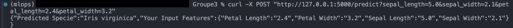
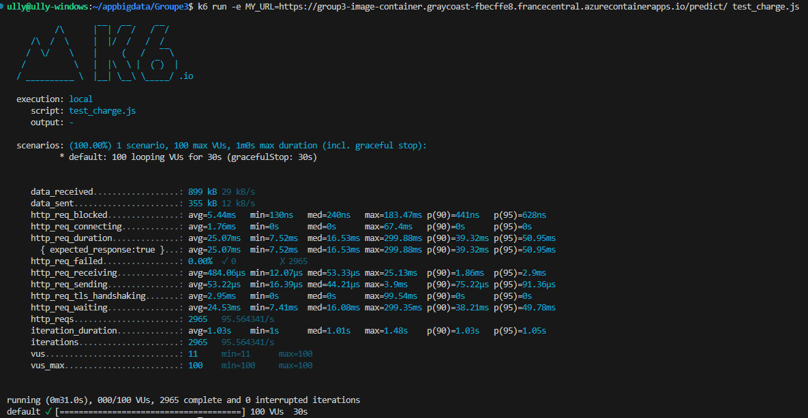
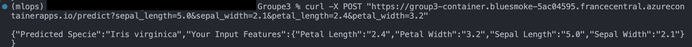
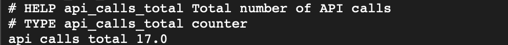

# Iris Prediction API (MLOps)

An end-to-end MLOps pipeline for a simple ML model: train it, serve it behind a REST API, containerize it, ship it to the cloud through CI/CD, and observe it in production — the full lifecycle, not just the model.

The model itself (a KNN classifier on the classic Iris dataset) is intentionally simple. The point of the project is everything *around* it: packaging, automated deployment, monitoring, and load testing, exactly as you'd operate a real ML service.

## 🎯 What it does

- Trains a K-Nearest Neighbors classifier to predict an Iris flower's species (*setosa*, *versicolor*, *virginica*) from 4 measurements (sepal/petal length and width), with every training run tracked in MLflow (parameters, metrics, model)
- Serves it behind a Flask REST API (`/predict`)
- Exposes Prometheus-compatible metrics (`/metrics`) — e.g. total API calls — scraped by Prometheus and visualized in Grafana
- Covered by a pytest suite (model quality, MLflow tracking, API behaviour) that runs in GitHub Actions and gates the deployment
- Ships as a Docker image, deployed automatically to Azure Container Apps via GitHub Actions on every push to `main` once the tests pass, with HTTP-concurrency-based autoscaling
- Load-tested with both k6 and Locust to validate autoscaling under traffic

## 🏗 Architecture

```
model.py  →  model.pkl                 (offline training; scaler + KNN exported as one Pipeline)
   │              │
   └─ MLflow ─────┘                    (params, metrics, model logged for every run)
                 │
                 ▼
get_model.py (Flask)  ──/predict──▶  KNN prediction (species + input echo)
      │            └──/metrics──▶  Prometheus exposition format
      │
      ▼
Docker image  ──git push──▶  GitHub Actions (pytest → build)  ──▶  Azure Container Registry
                                                          │
                                                          ▼
                                            Azure Container Apps (autoscaling)
                                                          │
                                    ┌─────────────────────┼─────────────────────┐
                                    ▼                                           ▼
                        Prometheus (scrapes /metrics)              k6 / Locust (load testing)
                                    │
                                    ▼
                                Grafana (dashboards)
```

Locally, `docker-compose.yaml` spins up the same three pieces (API + Prometheus + Grafana) together for development without needing Azure.

## 🧰 Tech stack

| Layer | Tool |
|---|---|
| Model training | scikit-learn (Pipeline: StandardScaler + KNN), joblib |
| Experiment tracking | MLflow (parameters, metrics, logged model) |
| API | Flask |
| Testing | pytest (model, MLflow tracking, API) |
| Metrics | prometheus-client (custom `api_calls_total` counter) |
| Containerization | Docker, docker-compose |
| Monitoring | Prometheus (scraping), Grafana (dashboards) |
| CI/CD | GitHub Actions |
| Container registry & hosting | Azure Container Registry, Azure Container Apps |
| Dockerfile linting | Hadolint |
| Load testing | k6, Locust |

## 📂 Project structure

```
model.py                    # offline training script: MLflow tracking + model.pkl
model.pkl                   # trained scaler + KNN pipeline (included)
get_model.py                # Flask API: /predict and /metrics
tests/                      # pytest suite (model, MLflow tracking, API)
requirements.txt            # runtime dependencies (what the Docker image installs)
requirements-dev.txt        # + MLflow and pytest, for training and testing
Dockerfile                  # container image for the API
docker-compose.yaml         # API + Prometheus + Grafana, for local dev
prometheus/prometheus.yaml  # Prometheus scrape config
grafana-provisioning/       # Grafana provisioning (datasources/dashboards)
.github/workflows/deploy.yaml  # test → lint → build → push to ACR → deploy → autoscaling
test_charge.js              # k6 load test
test_charge.py              # Locust load test
```

## 📈 Training and experiment tracking (MLflow)

```bash
pip install -r requirements-dev.txt
python model.py                      # train with the defaults (k=5)
python model.py --n-neighbors 7      # another run, to compare
mlflow ui --backend-store-uri sqlite:///mlflow.db
```

Each run of `model.py` is logged to the `iris-knn` experiment:

| Logged | What |
|---|---|
| Parameters | `n_neighbors`, `test_size`, `random_state`, model and scaler type |
| Metrics | `accuracy`, `f1_macro` on the held-out split |
| Model | the fitted pipeline, with an input/output signature and an input example |

`model.py` also writes `model.pkl`, the file the API loads. The scaler and the KNN are exported **together as one scikit-learn `Pipeline`**: the classifier is trained on standardised features, so the service has to apply the same standardisation to the raw measurements it receives. Set `MLFLOW_TRACKING_URI` to log to a remote tracking server instead of the local `mlflow.db`.

## 🧪 Tests

```bash
pip install -r requirements-dev.txt
pytest
```

| File | Covers |
|---|---|
| `tests/test_model.py` | training returns a scaler + KNN pipeline, accuracy and F1 above 0.9, `n_neighbors` is honoured, raw measurements of each species are classified correctly, the MLflow run records the right parameters, metrics and model, and the committed `model.pkl` is the scaled pipeline |
| `tests/test_api.py` | `/predict` returns the right species for a setosa, a versicolor and a virginica, echoes the inputs, reports an error when features are missing, and `/metrics` exposes `api_calls_total`, which increments once per successful prediction |

The tests run in GitHub Actions on every push and pull request. The build-and-deploy job `needs` them, so a failing test blocks the deployment; pull requests only run the tests.

## 🚀 Usage / deployment walkthrough

- App test in local (run get_model.py)
```
curl -X POST "http://127.0.0.1:5000/predict?sepal_length=5.0&sepal_width=2.1&petal_length=2.4&petal_width=3.2"
```



- Build docker image
```
docker build -t iris-predictor .
```

- Image run in local
```
docker run -p 5000:5000 iris-predictor
```

- Login to azure ACR
```
az login
az acr login --name efreibigdata.azurecr.io
```

- Tag the image
```
docker tag iris-predictor efreibigdata.azurecr.io/iris-predictor:latest
```

- Push image to azure
```
docker push efreibigdata.azurecr.io/iris-predictor:latest
az acr repository list --name efreibigdata.azurecr.io --output table
```

- Test charge (k6 avec js)
```
k6 run -e MY_URL=https://iris-predictor-container.bluesmoke-5ac04595.francecentral.azurecontainerapps.io/predict/test_charge.js
```



- Test predict on the app
```
curl -X POST "https://iris-predictor-container.bluesmoke-5ac04595.francecentral.azurecontainerapps.io/predict?sepal_length=5.0&sepal_width=2.1&petal_length=2.4&petal_width=3.2"
```



- Make 10 requests to test the api auto scaling
```
for i in {1..10}; do curl -X POST "https://iris-predictor-container.bluesmoke-5ac04595.francecentral.azurecontainerapps.io/predict?sepal_length=5.0&sepal_width=2.1&petal_length=2.4&petal_width=3.2"; done
```

- Prometheus /metrics
```
curl https://iris-predictor-container.bluesmoke-5ac04595.francecentral.azurecontainerapps.io/metrics
```

- Prometheus /metrics filtered on 'api_calls_total'
```
curl https://iris-predictor-container.bluesmoke-5ac04595.francecentral.azurecontainerapps.io/metrics | grep 'api_calls_total'
```



## Running locally with Docker Compose

```bash
docker-compose up
```

This starts the API on `:5000`, Prometheus on `:9090`, and Grafana on `:3000` — all networked together, with Prometheus already configured to scrape the API's `/metrics` endpoint.
